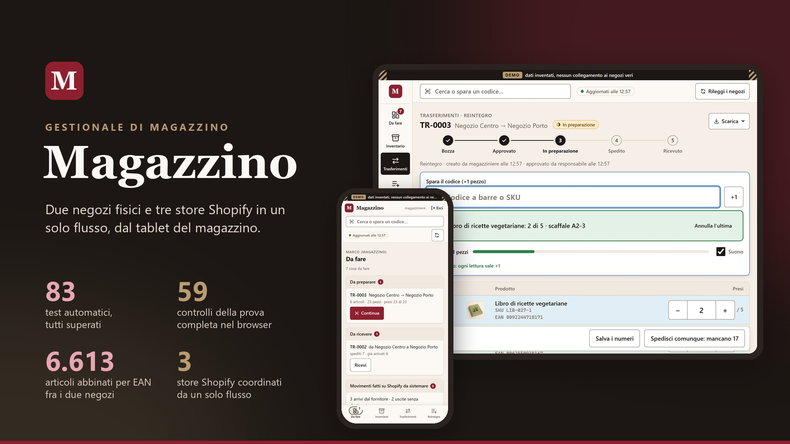
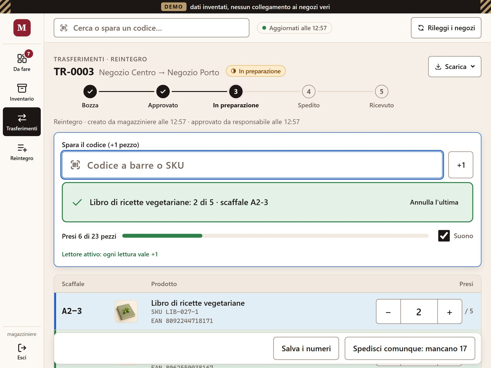
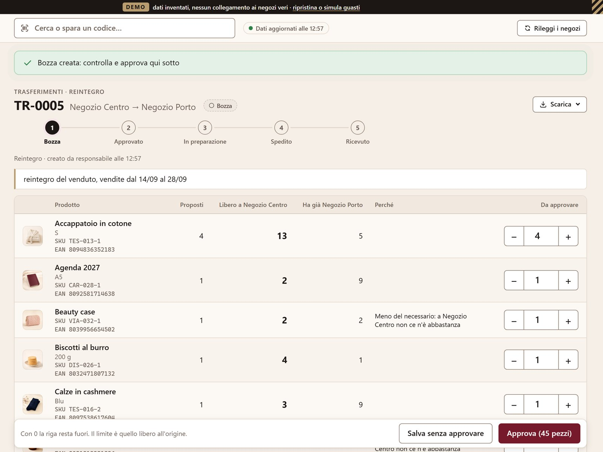
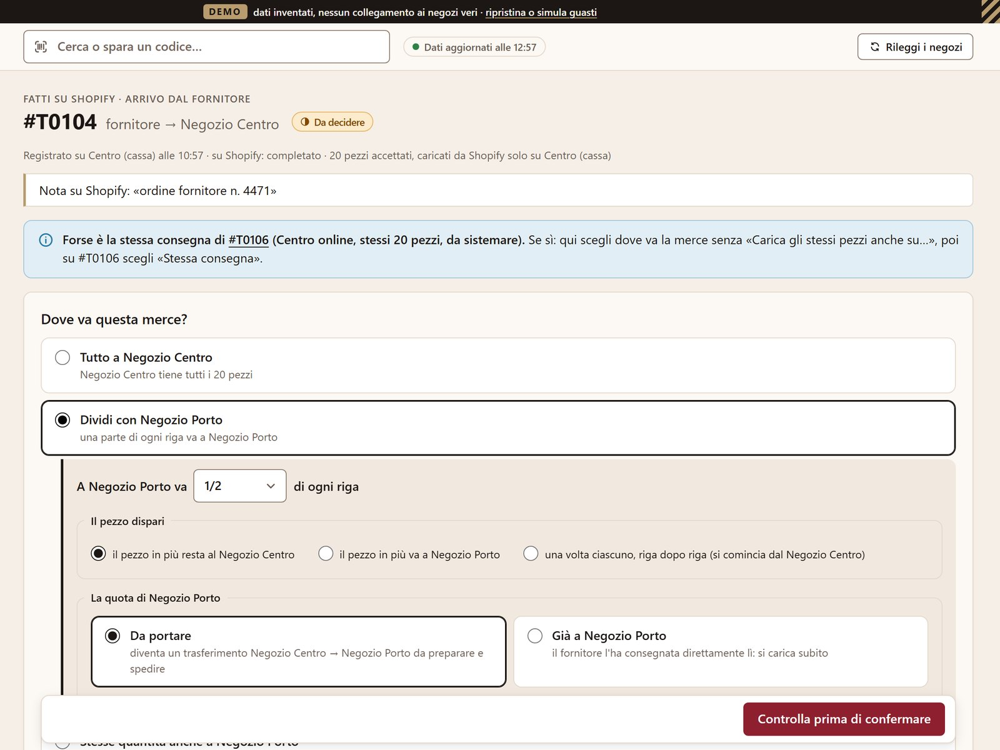

# Gestione magazzino multinegozio per Shopify

**Due negozi fisici, tre siti Shopify, un solo modo di lavorare.**

Magazzino fa di Shopify il gestionale di un rivenditore con due negozi fisici a Napoli e tre siti online. Dietro le quinte automatizza i movimenti di merce e ripulisce i dati. Chi lavora in negozio usa un'app semplice dal tablet, con il lettore di codici a barre, senza dover imparare Shopify. Il responsabile approva o corregge il lavoro dalla stessa app.



## In breve

- **Il problema.** Shopify fa già da gestionale, ma non sposta merce fra siti diversi. Uno spostamento fra i due negozi richiedeva 4 passaggi a mano in 3 posti, e bastava un errore per disallineare le giacenze.
- **La scelta.** Niente gestionale nuovo da comprare e niente dati da migrare. Shopify resta dov'è; davanti c'è un'app che parla la lingua del negozio.
- **Per chi lavora.** Una lista «Da fare», il lettore di codici a barre, pulsanti grandi. Niente Shopify da imparare, e niente prezzi o vendite sotto gli occhi di chi prepara.
- **Per il responsabile.** Approva, corregge e decide prima che la merce si muova. Ogni movimento ha un nome, un'ora, il prima e il dopo.
- **Cosa ha già trovato.** Alla prima lettura dei negozi veri, 263 anomalie nei dati, ognuna con cosa fare.
- **A che punto è.** In prova sui negozi veri, in sola lettura. Gli aggiornamenti delle giacenze sono pronti e si accendono dopo 5 decisioni operative.
- **In quanto tempo.** Prima versione in tre giorni, restyling in uno: analisi e regole mie, codice scritto con Claude Code.

## Il problema

Il rivenditore ha due negozi fisici, qui negozio A e negozio B, e vende da tre siti Shopify. Il negozio A vende da due siti, quello collegato alla cassa e lo shop online, con la stessa merce; il negozio B vende dal suo. Catalogo, giacenze e ordini vivono su Shopify, che di fatto è il gestionale dell'azienda.

Shopify però è pensato per vendere. Per muovere merce fra due negozi bisognava arrangiarsi:

- **Spostamenti a mano.** Shopify non sposta merce fra siti diversi. Per mandare dieci pezzi dal negozio A al negozio B servivano quattro passaggi in tre posti: il trasferimento nell'admin di Shopify, due programmini da lanciare a mano (uno carica il negozio di arrivo, l'altro ripete lo scarico sul secondo sito del negozio A) e una nota scritta a mano in un registro.
- **Carichi a metà.** Un arrivo da fornitore registrato su un sito non compare sull'altro, e andava registrato due volte.
- **Dati sporchi.** Codici a barre mancanti o doppi, articoli presenti su un sito e non sull'altro, giacenze diverse fra cassa e online. Non c'era un elenco unico di cosa non tornava: i problemi si scoprivano lavorando.
- **Controllo a cose fatte.** Chi faceva un movimento lo scriveva direttamente su Shopify, e il responsabile se ne accorgeva solo dopo.

E poi ci sono le persone. Chi lavora in negozio e in magazzino non è per forza un nativo digitale. L'admin di Shopify ha decine di schermate, e un clic sbagliato cambia la giacenza che vede il cliente online. Formare tutti su Shopify costa tempo, e il rischio di errore resta.

Il risultato sono giacenze che non tornano, senza sapere qual è il numero giusto. Il rischio è vendere online un pezzo che non c'è più, o lasciare fermo in magazzino un pezzo che online non si vede.

## La soluzione: Shopify resta il gestionale, le persone usano un'app semplice

Invece di insegnare Shopify a tutti, ho costruito un'app che si mette davanti a Shopify: si apre dal browser del tablet e usa le parole del negozio, cioè Da fare, Prepara, Spedisci, Ricevi. Catalogo, giacenze e ordini restano su Shopify. L'app ci lavora sopra e fa quattro cose.

| Cosa fa | In pratica |
|---|---|
| **Automatizza** | Uno spostamento aggiorna da solo tutti i siti coinvolti, in partenza e all'arrivo. Un carico da fornitore si copia sull'altro sito, o si divide con l'altro negozio, in un passaggio solo. |
| **Pulisce i dati** | A ogni lettura trova quello che non torna (codici mancanti o doppi, articoli che mancano su un sito, giacenze negative) e per ogni caso dice cosa fare. |
| **Guida chi lavora** | Ognuno vede solo il proprio lavoro, in una lista «Da fare». Si lavora col lettore di codici a barre, la lista segue gli scaffali e un suono conferma ogni pezzo. |
| **Lascia decidere il responsabile** | Ogni movimento passa da un'anteprima, e le decisioni che contano passano dal responsabile: approva e corregge i trasferimenti, chiude le differenze, conferma le correzioni di giacenza. |

## Una giornata con Magazzino

Il negozio B ha venduto e va rifornito dal negozio A. Il trasferimento passa per cinque stati (bozza, approvato, in preparazione, spedito, ricevuto), e in ogni momento si sa a che punto è e chi deve muoversi.

1. **Responsabile.** Apre il reintegro e sceglie «ultimi 7 giorni». L'app propone di rimandare al negozio B quello che ha venduto e che nessuno ha ancora rimandato, prendendolo dal negozio A. Spunta le righe e nasce la bozza.
2. **Responsabile.** Rivede la bozza con i numeri davanti, cioè quanto è libero nel negozio A e quanto ha già il B, corregge un paio di quantità e approva. Da qui i pezzi sono prenotati: nessun'altra lista li può promettere.
3. **Magazziniere del negozio A.** Trova il trasferimento in «Da fare» e preme «Prepara». Gira con il tablet seguendo l'ordine degli scaffali: ogni codice sparato è un pezzo, un suono conferma, una vibrazione avverte se il pezzo è sbagliato. Un articolo non si trova: spedisce lo stesso e scrive il motivo.
4. **L'app.** Prima di spedire mostra cosa cambierà su ciascun sito e ricontrolla le giacenze su Shopify. Se intanto qualcuno ha comprato online uno di quei pezzi, si ferma e indica la riga da ridurre. Alla conferma toglie i pezzi dal negozio A, sulla cassa e sullo shop online insieme.
5. **Magazziniere del negozio B.** All'arrivo trova i numeri già compilati come «arrivato tutto» e corregge solo quello che manca o è rotto, oppure conta col lettore. I pezzi buoni entrano nel negozio B.
6. **Responsabile.** Mancanti e rotti diventano differenze da chiudere: pezzo perso, tornato indietro o arrivato dopo. Ogni chiusura ha il suo motivo e resta nello storico.

<p>
  
  
</p>

*A sinistra la preparazione: ogni codice letto è un pezzo, la riga diventa verde quando è completa. A destra l'approvazione, con i numeri davanti. Le immagini vengono dalla demo, con negozi e prodotti inventati.*

Nella stessa giornata:

- un collega registra su Shopify un arrivo da fornitore solo sulla cassa: alla lettura successiva l'app chiede «Dove va questa merce?» e propone di copiarlo sullo shop online o di dividerlo con l'altro negozio;
- qualcuno fa un'uscita dall'admin di Shopify senza indicare dove va la merce: l'app chiede «Dov'è andata la merce?», suggerisce il negozio e spiega perché;
- il responsabile apre le anomalie, raggruppate per urgenza con il «Cosa fare» accanto, e chiude in blocco, con un motivo, quelle che non vanno corrette.



## Dove decide il responsabile

- Approva i trasferimenti e ne corregge le quantità.
- Approva la quota di un carico che il magazziniere ha diviso con l'altro negozio.
- Chiude le differenze all'arrivo.
- Conferma ogni correzione di giacenza, dicendo da dove viene il numero giusto.
- Collega a mano gli articoli che non si abbinano da soli, con un motivo.
- Decide sui movimenti rimasti in dubbio, per esempio quando Shopify non ha risposto.
- Segna come «già gestito» un movimento fatto fuori dall'app, con una nota.

Tutto resta nello storico: chi, quando, il prima e il dopo.

## Cosa cambia

| Prima | Con Magazzino |
|---|---|
| 4 passaggi a mano in 3 posti per registrare uno spostamento | un flusso solo: i siti si aggiornano mentre si prepara, si spedisce e si riceve |
| un arrivo da fornitore registrato due volte, una per sito | copiato sull'altro sito o diviso con l'altro negozio in un passaggio |
| i problemi nei dati si scoprivano lavorando | un elenco unico, ricalcolato a ogni lettura, con cosa fare per ognuno |
| il responsabile vedeva i movimenti a cose fatte | approva e corregge prima che la merce si muova |
| per lavorare bisognava conoscere l'admin di Shopify | bastano il tablet, il lettore e la lista «Da fare» |

- **Per chi prepara e riceve:** un'app sola, con poche parole. Vede solo il suo lavoro, senza prezzi né vendite, e un doppio tocco o una pagina ricaricata non combinano guai.
- **Per il responsabile:** vede cosa c'è da approvare e cosa non torna, e per ogni numero sa chi l'ha toccato e quando.
- **Per l'azienda:** giacenze allineate sui tre siti, dati che si ripuliscono un po' ogni giorno, nessun gestionale nuovo da comprare né da imparare.

## I numeri

Il 25 settembre 2026 l'app ha letto i negozi veri in sola lettura, senza modificare niente:

- **20.536 varianti** lette dai tre siti in **1 minuto e 36 secondi**;
- **6.613 articoli** abbinati fra i due negozi con il codice a barre;
- **263 anomalie** trovate alla prima lettura.

| Anomalia | Quante |
|---|---:|
| Codice a barre mancante, su articoli con merce | 82 |
| Articolo che manca sullo shop online gemello | 62 |
| Articolo con merce in un solo negozio | 57 |
| Codice a barre doppio | 47 |
| Cassa e shop online con giacenze diverse | 14 |
| Giacenza negativa | 1 |
| **Totale** | **263** |

Ognuna arriva con il suo «Cosa fare». Alcune di solito non vanno corrette, come un articolo che esiste davvero in un solo negozio, e si chiudono in blocco con un motivo.

Regole e flussi sono coperti da prove automatiche: 125 su calcoli, flussi, sicurezza e pagine, più 59 controlli sulle schermate, tablet e telefono compresi. Il dettaglio è in [docs/TEST.md](docs/TEST.md).

## A che punto è

Oggi l'app gira sulla demo e legge i negozi veri. Gli aggiornamenti delle giacenze vere sono pronti e provati sulla demo, ma restano spenti finché non si decidono cinque regole che cambiano i movimenti reali:

1. **Quale sito fa fede per il negozio A:** quello della cassa o lo shop online.
2. **Quando togliere la merce all'origine:** alla spedizione, come previsto oggi, o già alla preparazione, così online non si vende quello che è nello scatolone.
3. **Se i trasferimenti devono comparire anche nell'admin di Shopify,** come quando si facevano a mano.
4. **Le scorte minima e obiettivo:** oggi 1 e 2 pezzi per negozio, e quali articoli meritano soglie proprie.
5. **Se permettere le correzioni di giacenza,** e con quale prova: sempre un conteggio fisico, o anche «la cassa ha ragione».

Le regole sono spiegate a parole in [docs/REGOLE.md](docs/REGOLE.md). Dopo l'avvio si misurano il tempo dall'approvazione alla ricezione, i pezzi mancanti o rotti per trasferimento, le anomalie aperte e chiuse ogni settimana e quante volte cassa e shop online risultano disallineati. Numeri d'uso, per ora, non ce ne sono.

## Tutte le funzioni

Sono 55, divise in 10 aree. L'elenco completo, con il problema di tutti i giorni da cui nasce ogni funzione, è in [docs/FUNZIONI.md](docs/FUNZIONI.md).

| Area | Funzioni | Per esempio |
|---|---:|---|
| Accesso e ruoli | 5 | il magazziniere non vede mai prezzi né vendite |
| Lettura dei negozi | 3 | i tre siti riletti da soli ogni quarto d'ora |
| Inventario | 8 | i due negozi affiancati, con lo scaffale di ogni articolo |
| Reintegro e bilanciamento | 5 | la stessa vendita non viene mai rimandata due volte |
| Trasferimenti fra negozi | 14 | preparazione col lettore, in ordine di scaffale |
| Movimenti fatti su Shopify | 5 | un arrivo registrato su un solo sito viene completato sugli altri |
| Aggiornamenti sicuri | 4 | se la rete cade a metà, nessun movimento raddoppia |
| Pulizia dei dati | 4 | anomalie per urgenza, ognuna con cosa fare |
| Documenti | 2 | lista di prelievo su carta, export in Excel |
| Facile per chi non è digitale | 5 | suono e vibrazione a ogni lettura del codice |

## Come è nato

L'idea, l'analisi del lavoro in negozio, le regole e il collaudo sono miei. Il codice è scritto con [Claude Code](https://claude.com/claude-code), l'agente di programmazione di Anthropic, sotto la mia direzione: la prima versione ha richiesto tre giorni, il restyling uno. Per semplificare le schermate ho fatto rivedere l'app da due agenti AI con ruoli distinti, un product manager e un graphic designer; il product manager ha anche trovato un buco nel controllo prima della spedizione, che è stato chiuso. Il racconto del restyling, con le schermate prima e dopo, è in [docs/PORTFOLIO.md](docs/PORTFOLIO.md).

## Provala

La demo gira sul proprio PC, con negozi e prodotti inventati. Su Windows, con Python installato:

```bash
python -m venv .venv
.venv\Scripts\pip install -r requirements.txt
.venv\Scripts\python magazzino.py --demo
```

Poi apri `http://127.0.0.1:8000` ed entra come `magazziniere` o `responsabile`, password `demo1234`.

## Per chi guarda il codice

Python con FastAPI e SQLite, pagine generate dal server, nessun servizio esterno oltre a Shopify. Avvio sui negozi veri, struttura del codice, test e sicurezza sono in [docs/TECNICO.md](docs/TECNICO.md). La guida per chi prepara e riceve è in [docs/GUIDA-MAGAZZINIERE.md](docs/GUIDA-MAGAZZINIERE.md).

---

Il cliente resta anonimo: in questo repository ci sono solo la demo, con negozi e prodotti inventati, e un esempio di configurazione. I negozi veri stanno in un file che resta sul PC del negozio. Le foto dei prodotti della demo sono generate con un modello di OpenAI.
